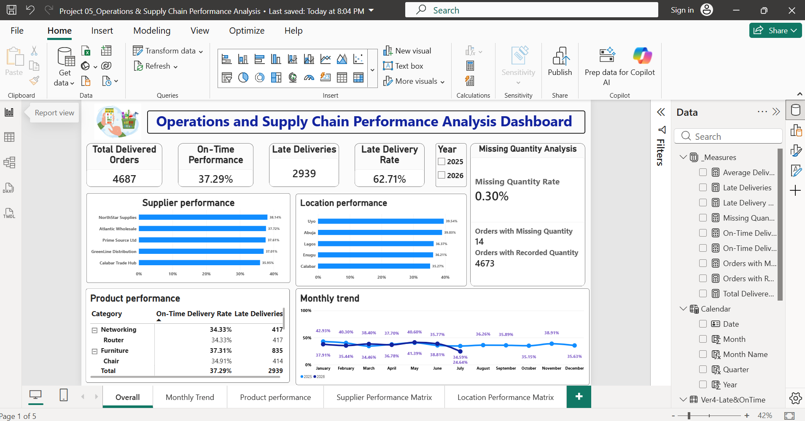
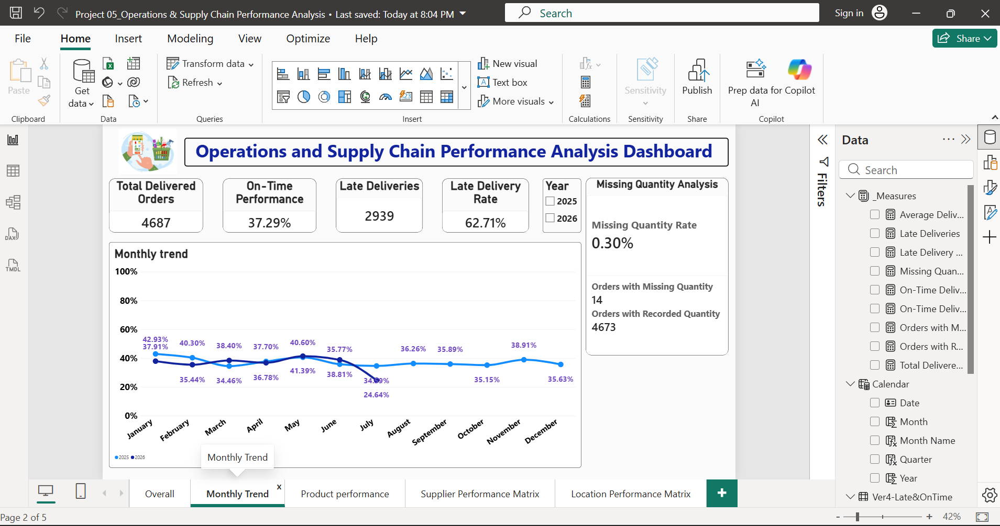
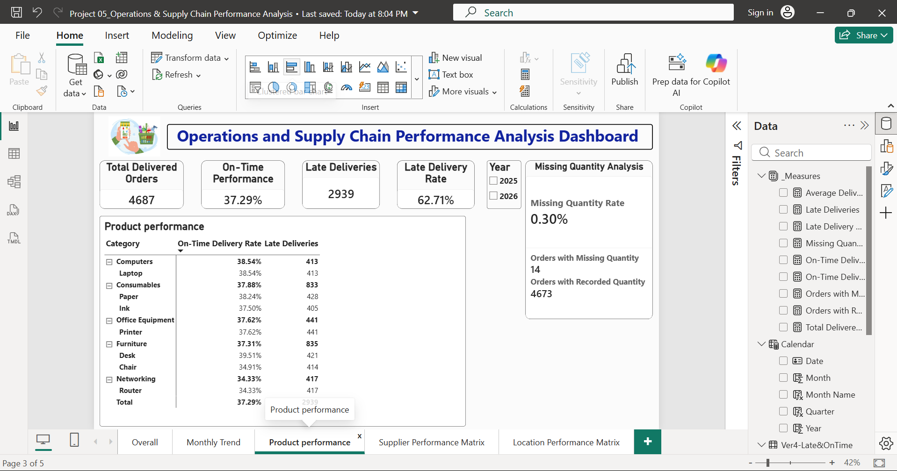
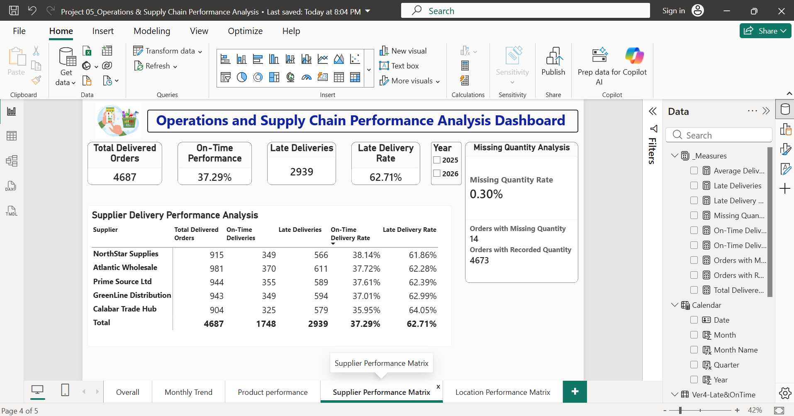
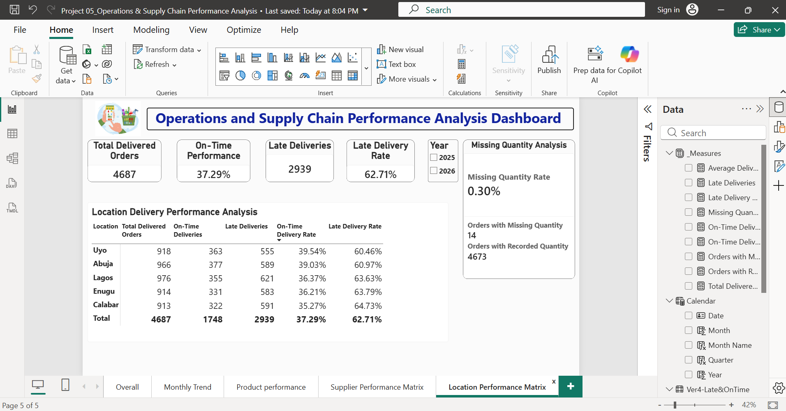

# Operations and Supply Chain Performance Analysis Dashboard

**Project:** Project 05 – Operations and Supply Chain Performance Analysis  
**Organisation:** HarbourLink Distribution Services  
**Project Type:** Data Analytics / Business Intelligence  
**Tools:** Microsoft Excel, Microsoft Power BI, DAX  
**Status:** Dashboard and Analysis Completed – Documentation and Repository Updates Ongoing

---

## 1. Project Title

**Operations and Supply Chain Performance Analysis Dashboard**

This project analyses delivery performance at HarbourLink Distribution Services, focusing on supplier performance, product categories, delivery locations and monthly delivery trends.

The project uses data analysis and interactive Power BI visualisations to identify delivery performance gaps, highlight operational patterns and provide evidence-based recommendations for improving supply chain efficiency.

## 2. Business Problem Statement

HarbourLink Distribution Services has experienced customer complaints relating to late deliveries and incomplete orders. Management requires a clearer understanding of delivery performance across suppliers, products and distribution locations.

However, inconsistent reporting, missing data and limited visibility into delivery trends make it difficult to identify underperforming areas and determine where operational improvements are required.

The business therefore needs a data-driven approach to:

- Measure on-time and late delivery performance.
- Compare supplier delivery performance.
- Identify locations with relatively weak delivery performance.
- Examine delivery performance across product categories.
- Monitor monthly delivery trends.
- Identify data-quality issues.
- Provide actionable recommendations to support operational decision-making.

## 3. Company Background

HarbourLink Distribution Services is a fictional distribution organisation used for this workplace simulation.

The organisation works with multiple suppliers to distribute different product categories across several delivery locations.

Its operations depend on effective supplier coordination, inventory availability, order processing and timely distribution to customers.

The Operations Manager requires an evidence-based assessment of delivery performance to support supplier engagement, operational reviews and service-level monitoring.

## 4. Project Objectives

The objectives of this project are to:

1. Evaluate overall delivery performance using on-time and late delivery indicators.
2. Compare delivery performance across suppliers.
3. Assess delivery performance across different locations.
4. Identify product categories and individual products with relatively strong or weak delivery performance.
5. Analyse monthly delivery performance trends.
6. Identify missing values and other potential data-quality issues.
7. Develop an interactive Power BI dashboard for performance monitoring.
8. Recommend practical actions to improve delivery reliability and operational decision-making.

## 5. Dataset Description

The project uses an Excel workbook named `dataset_raw`, containing the original order-level dataset in a single worksheet.

The original dataset (`Original_Ver1`) contained **5,010 order records** across 10 columns:

`Order_ID`, `Order_Date`, `Promised_Date`, `Delivery_Date`, `Supplier`, `Product`, `Category`, `Quantity`, `Status`, and `Location`.

The dataset covered:
- 5 suppliers
- 7 products
- 5 delivery locations
- 5,010 original order records

**Data preparation and classification**

The workbook was developed through five versions:

| Worksheet | Description |
|---|---|
| `Original_Ver1` | Original, unmodified dataset |
| `Ver2` | Duplicate records removed and supplier/location text inconsistencies corrected |
| `Ver3` | Date columns converted to proper date formats |
| `Ver4-Late&OnTime` | Delivered orders classified as On Time or Late |
| `Ver5-Cancelled` | Orders classified as Cancelled |

After cleaning and classification, the dataset contained **5,000 unique orders**, comprising:

- 4,687 delivered orders (On Time and Late)
- 313 cancelled orders

Only `Ver4-Late&OnTime` and `Ver5-Cancelled` were imported into Power BI for analysis.

## 6. Tools and Technologies Used

| Tool / Technology | Purpose |
|---|---|
| Microsoft Excel | Initial data inspection and preparation |
| Microsoft Power BI | Data modelling, analysis and dashboard development |
| DAX | Creation of calculated measures and KPIs |
| Power Query | Data transformation and preparation, where applicable |
| GitHub | Project documentation and version control |

## 7. Methodology

The project followed a structured data preparation, analysis, and visualization process.

**Step 1: Data Inspection**

The original Excel dataset was reviewed to identify data quality issues, including:
- 10 duplicate order records.
- 15 records with missing quantity values.
- Extra spaces in some supplier names.
- Inconsistent capitalization in location names.
- 313 orders without delivery dates.

**Step 2: Data Cleaning**

A working copy of the original dataset was created in `Ver2`.

The following transformations were performed:
- Removed 10 duplicate records using `Order_ID` as the deduplication key. The duplicate records had identical entries across all columns.
- Trimmed supplier names to remove unnecessary spaces.
- Standardized location names using proper case.

This reduced the dataset from 5,010 to 5,000 unique order records.

**Step 3: Date Formatting**

A copy of the cleaned dataset was created in `Ver3`. The `Order_Date`, `Promised_Date`, and `Delivery_Date` columns were formatted as date values.

**Step 4: Delivery Status Classification**

An `Is Delivery On Time?` column was added using an Excel formula to classify records:

- **Cancelled:** No delivery date recorded.
- **On Time:** Delivery date was on or before the promised date.
- **Late:** Delivery date was after the promised date.

**Step 5: Dataset Segregation**

The cleaned dataset was separated into two worksheets:

- `Ver4-Late&OnTime`: Retained On Time and Late orders (4,687 records).
- `Ver5-Cancelled`: Retained Cancelled orders (313 records).

**Step 6: Power BI Import and Modelling**

The two prepared worksheets were imported into Power BI. The delivered-orders table was used for the main delivery performance analysis, while cancelled orders were kept separately.

A Calendar table was created and marked as a date table. It was connected to the delivered-orders table through `Delivery_Date` to support monthly and yearly delivery trend analysis.

**Step 7: DAX Measures and Dashboard Development**

DAX measures were created to calculate:
- Total Delivered Orders
- On-Time Deliveries
- Late Deliveries
- On-Time Delivery Rate
- Late Delivery Rate
- Orders with Missing Quantity
- Missing Quantity Rate
- Average Delivery Lead Time

The measures were used to develop KPI cards, supplier and location comparisons, product performance analysis, monthly delivery trends, and missing quantity analysis.

## 8. Exploratory Data Analysis (EDA)

The exploratory analysis focused on four major dimensions.

**A. Supplier Analysis**

Examined total delivered orders, on-time deliveries, late deliveries and on-time delivery rates across five suppliers.

**B. Location Analysis**

Compared delivery performance across Uyo, Abuja, Lagos, Enugu and Calabar.

**C. Product Analysis**

Examined delivery performance across five product categories and seven individual products.

**D. Monthly Trend Analysis**

Compared monthly on-time delivery rates across 2025 and 2026 to identify periods of stronger and weaker performance.

Data-quality checks also examined missing quantity values and the consistency of delivery classifications.

## 9. Key Findings

### Overall Delivery Performance

| KPI | Result |
|---|---:|
| Total Delivered Orders | 4,687 |
| On-Time Deliveries | 1,748 |
| Late Deliveries | 2,939 |
| On-Time Delivery Rate | 37.29% |
| Late Delivery Rate | 62.71% |
| Orders with Missing Quantity | 14 |
| Missing Quantity Rate | 0.30% |

### A. Supplier Performance

| Supplier | Delivered Orders | On-Time Rate | Late Deliveries |
|---|---:|---:|---:|
| NorthStar Supplies | 915 | 38.14% | 566 |
| Atlantic Wholesale | 981 | 37.72% | 611 |
| Prime Source Ltd | 944 | 37.61% | 589 |
| GreenLine Distribution | 943 | 37.01% | 594 |
| Calabar Trade Hub | 904 | 35.95% | 579 |

**Findings:**

- NorthStar Supplies recorded the highest on-time delivery rate (38.14%).
- Calabar Trade Hub recorded the lowest rate (35.95%).
- Atlantic Wholesale recorded the highest number of late deliveries (611).
- The difference between the highest and lowest supplier on-time rates was 2.19 percentage points.

### B. Location Performance

| Location | Delivered Orders | On-Time Rate | Late Deliveries |
|---|---:|---:|---:|
| Uyo | 918 | 39.54% | 555 |
| Abuja | 966 | 39.03% | 589 |
| Lagos | 976 | 36.37% | 621 |
| Enugu | 914 | 36.21% | 583 |
| Calabar | 913 | 35.27% | 591 |

**Findings:**

- Uyo recorded the highest on-time delivery rate (39.54%).
- Calabar recorded the lowest rate (35.27%).
- Lagos recorded the highest number of late deliveries (621).
- The performance gap between Uyo and Calabar was 4.27 percentage points.

### C. Product Performance

**Category-level performance**

| Product Category | On-Time Rate | Late Deliveries |
|---|---:|---:|
| Networking | 34.33% | 417 |
| Furniture | 37.31% | 835 |
| Office Equipment | 37.62% | 441 |
| Consumables | 37.88% | 833 |
| Computers | 38.54% | 413 |

**Individual product performance**

| Product | On-Time Rate | Late Deliveries |
|---|---:|---:|
| Router | 34.33% | 417 |
| Chair | 34.91% | 414 |
| Desk | 39.51% | 421 |
| Printer | 37.62% | 441 |
| Ink | 37.50% | 405 |
| Paper | 38.24% | 428 |
| Laptop | 38.54% | 413 |

**Findings:**

- Computers recorded the highest category-level on-time rate (38.54%).
- Networking recorded the lowest category-level rate (34.33%).
- Furniture and Consumables recorded the highest late-delivery volumes.
- Desk recorded the highest individual product on-time rate (39.51%).
- Router recorded the lowest individual product on-time rate (34.33%).

### D. Monthly Delivery Performance Trend

The monthly trend dashboard compares delivery performance across 2025 and 2026.

**Findings:**

- January 2025 recorded an on-time delivery rate of approximately 42.93%.
- March 2025 recorded a decline to approximately 34.46%.
- May 2025 recorded approximately 41.39%.
- May 2026 recorded approximately 40.60%.
- July 2026 recorded a significant decline to approximately 24.64%.
- The 2026 trend covers only January to July in the available dashboard.

The monthly results indicate fluctuations in delivery performance and highlight periods requiring further investigation.

*Note: Monthly values are approximate readings from the dashboard visual and should be validated against the underlying data before being used as final audited figures.*

## 10. Visualizations

The Power BI dashboard uses the following visualisations:

| Visualization | Purpose |
|---|---|
| KPI Cards | Display total delivered orders, on-time performance and late deliveries |
| Supplier Performance Matrix | Compare supplier delivery rates and order volumes |
| Location Performance Matrix | Compare delivery performance across locations |
| Product Performance Matrix | Examine category and individual product performance |
| Monthly Trend Line Chart | Compare monthly delivery performance across years |
| Year Slicer | Filter dashboard results by reporting year |
| Missing Quantity Analysis | Monitor missing quantity records and data completeness |

## 11. Dashboard Screenshots

### Overall Performance Dashboard


### Monthly Delivery Trend


### Product Performance


### Supplier Performance


### Location Performance


### Download the Interactive Power BI Dashboard

The complete interactive Power BI report is available for download.

**[Download the Power BI Dashboard (.pbix)](dashboard/operations-supply-chain-dashboard.pbix)**

*To explore the report interactively, download the file and open it using Microsoft Power BI Desktop.*

## 12. Business Insights

The analysis generated the following business insights:

1. **Delivery reliability requires improvement:** With only 37.29% of delivered orders arriving on time, delivery performance is a significant operational concern.

2. **Supplier performance varies:** NorthStar Supplies performed relatively better, while Calabar Trade Hub recorded the lowest on-time rate. However, the differences across suppliers are relatively small.

3. **Location performance varies:** Uyo and Abuja recorded stronger delivery rates, while Calabar and Lagos require further operational investigation.

4. **Product-specific delivery challenges exist:** Networking, particularly Routers, recorded the weakest on-time delivery performance.

5. **High late-order volumes require context:** Furniture, Consumables and certain suppliers recorded high late-delivery counts, but their order volumes must be considered when interpreting the results.

6. **Monthly performance is inconsistent:** The decline observed in July 2026 highlights the importance of continuous monitoring and exception investigation.

7. **Data completeness matters:** Missing quantity records should be investigated to improve the reliability of future quantity-based analysis.

## 13. Recommendations

Based on the findings, the following actions are recommended:

| Priority | Recommendation | Responsible Function |
|---|---|---|
| High | Review supplier performance and establish corrective action plans. | Procurement |
| High | Investigate delivery delays in Lagos and Calabar. | Operations / Logistics |
| High | Investigate the July 2026 decline in delivery performance. | Operations |
| High | Review procurement and delivery processes for Networking products, especially Routers. | Procurement / Warehouse |
| Medium | Examine high late-delivery volumes in Furniture and Consumables. | Operations |
| Medium | Identify practices contributing to stronger performance in Uyo and Abuja. | Operations |
| Medium | Improve quantity data validation and completeness. | Warehouse / Data Management |
| Medium | Introduce monthly supplier and location performance scorecards. | Procurement / Operations |
| Medium | Collect additional inventory, freight and route-level information. | Supply Chain Management |

Management should prioritise investigations and corrective actions before making major supplier or operational decisions.

## 14. Limitations

The project has the following limitations:

1. **Incomplete order measurement:** The original `Quantity` field represented the number of items ordered, not the number of items actually delivered. Consequently, incomplete order fulfilment could not be measured directly.

2. **Missing quantity values:** The original dataset contained 15 orders with missing quantity information. The delivered-order analysis identified 14 such records. These records were retained in delivery timeliness calculations because missing quantities do not automatically invalidate delivery dates. The difference between the original and delivered-order counts should be reconciled.

3. **Cancelled orders:** The 313 cancelled orders were separated into another worksheet and excluded from the main delivered-order performance calculations.

4. **Delivery causes:** The available dataset does not establish the root causes of delivery delays.

5. **Inventory information:** Inventory balances and stock-out records were unavailable for determining the effect of inventory availability on delivery performance.

6. **Transportation information:** Freight costs and route-level data were unavailable for evaluating transportation cost efficiency and route performance.

7. **Monthly comparison:** The 2026 monthly trend covers January to July, making a full-year comparison with 2025 inappropriate.

8. **Data quality:** Although duplicate records and formatting inconsistencies were addressed during preparation, the analysis remains dependent on the accuracy and completeness of the original source records.
   
## 15. Future Improvements

Future development of the project could include:

1. Integrating inventory and stock-out data to investigate the relationship between product availability and delivery delays.
2. Incorporating freight costs and transportation data to evaluate delivery cost efficiency.
3. Developing supplier scorecards with agreed service-level targets.
4. Introducing delivery lead-time analysis to measure the time between order placement and delivery.
5. Comparing promised and actual delivery dates across suppliers and locations.
6. Analysing incomplete orders using ordered quantities and actual delivered quantities.
7. Developing automated monthly performance reports.
8. Introducing drill-through analysis to investigate specific suppliers, products and locations.
9. Extending the analysis as more 2026 data becomes available.
10. Establishing performance alerts for significant monthly declines in on-time delivery rates.

## 16. Repository Structure

The proposed GitHub repository structure is:

```text
operations-supply-chain-analysis-/
│
├── README.md
│
├── dashboard/
│   └── operations-supply-chain-dashboard.pbix
│
└── screenshots/
    ├── overall-dashboard.png
    ├── monthly-trend.png
    ├── product-performance.png
    ├── supplier-performance.png
    └── location-performance.png
```


## 17. Contributors

**Project Analyst:** Eruvwu Stephen Ijerhe

**Role:** Data Analyst / Business Intelligence Analyst

**Responsibilities:**
- Business problem analysis
- Data inspection and preparation
- Data modelling
- DAX measure development
- Exploratory data analysis
- Power BI dashboard development
- Interpretation of findings
- Management recommendations

**GitHub:** (https://github.com/sterijaz)

## 18. References

- HarbourLink Distribution Services – Project 05: Operations and Supply Chain Performance Analysis Workplace Simulation Brief.
- Microsoft Power BI Documentation: https://learn.microsoft.com/en-us/power-bi/
- Microsoft DAX Documentation: https://learn.microsoft.com/en-us/dax/
- Microsoft Power Query Documentation: https://learn.microsoft.com/en-us/power-query/

---

## Project Summary

This project demonstrates the application of data analytics and business intelligence techniques to an operational supply chain problem.

By combining data preparation, DAX calculations, exploratory analysis and interactive Power BI visualisations, the project provides management with a structured view of delivery performance across suppliers, products, locations and reporting periods.

The resulting dashboard establishes a performance baseline and supports evidence-based investigation, operational monitoring and continuous improvement.
